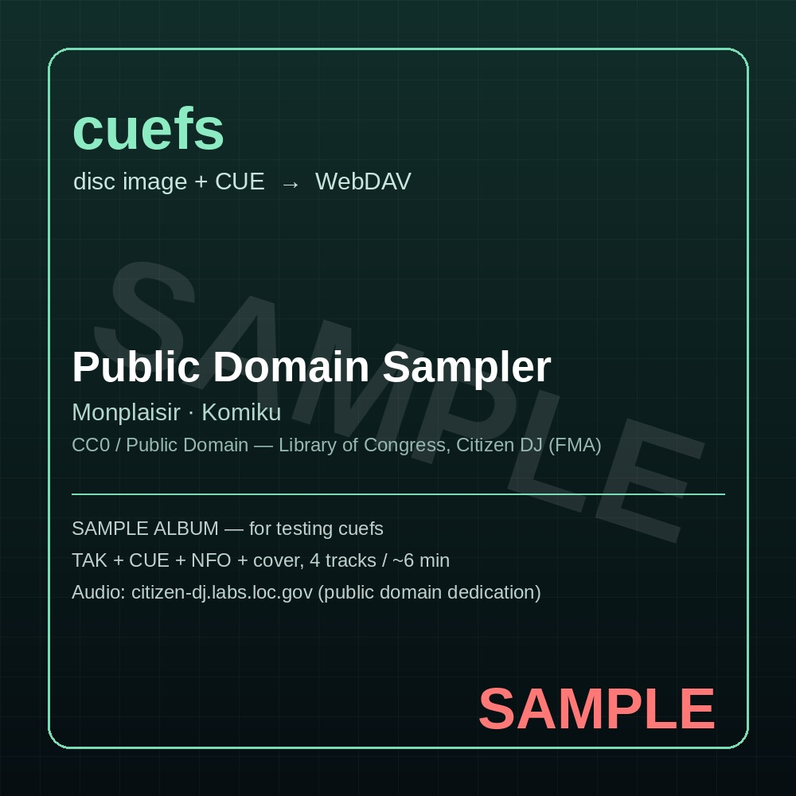

# cuefs

**把 TAK / FLAC / APE … 的「整盘 + CUE」镜像，变成 Jellyfin 能直接读的单曲库。**
不转码、不拆盘、不改原文件 —— 只在 Jellyfin 真的播放某一轨时，按 CUE 的时间轴把那一轨切出来。

<p align="center">
  
</p>

- 前端是 **WebDAV**：Jellyfin 侧用 rclone / davfs2 挂上来，库路径照常填。
- 原盘目录 **只读**；Jellyfin 想写 NFO / 封面时，**重定向**到另一个可写目录（overlay）。
- 支持 **TAK**（需要官方的闭源解码库 + Wine），也支持 **FLAC / WavPack / TTA / ALAC / AIFF / WAV / APE / MPC / Shorten** 等 ffmpeg 能解的整盘格式。
- 两个镜像：`cuefs:latest`（完整版，含 Wine，可解 TAK，**amd64**）和 `cuefs:slim`（精简版，408 MB，**amd64 + arm64**）。

> 英文简介：cuefs exposes "disc image + CUE" albums (TAK, FLAC, WavPack, TTA, ALAC, AIFF, WAV, APE…) as a
> read-only WebDAV tree of virtual tracks, so Jellyfin can index and stream them **without transcoding
> the original disc**. The source directory is never modified; Jellyfin's writes (NFO, artwork) are
> redirected to a separate overlay directory. TAK support uses the official freeware decoder library
> through Wine and is therefore **amd64 only**.

---

## 为什么

Jellyfin 至今（10.10 / 10.11）**不认 CUE、也不解码 TAK**，`xxx.tak + xxx.cue` 这种整盘镜像在库里
只是一坨“无法识别的文件”。现有做法几乎都是**离线拆盘转 FLAC**：

- 多占一份空间（原盘 + 拆出来的 FLAC，通常是 2 倍）；
- 原盘信息（pregap、碟号、cue 里的 REM）在转换里丢掉；
- 想换格式/换命名就得重来一遍。

cuefs 的思路反过来：**原盘一个字节都不动**，只在有人播放时按需切片并缓存。
位级验证过：逐轨切片再拼接回来的 PCM，与整盘解码的 PCM **MD5 完全相同**
（见 [docs/06-IMAGE-CUE.md](docs/06-IMAGE-CUE.md)）。

## 30 秒看懂它长什么样

```
/mnt/music-src/                     ← 目录 A（只读）：你自己的整盘
  ef - a tale of memories/
    GNCA-1135.tak
    GNCA-1135.cue
  ...

http://127.0.0.1:8099/              ← cuefs 输出的 WebDAV
  ef - a tale of memories. ORIGINAL SOUNDTRACK ～espressivo～/
    01 - Overture.flac              ← 虚拟文件，播放时才生成
    02 - ebullient future.flac
    ...
    cover.jpg                       ← 侧车：A 或 B 里的封面
    album.nfo

/mnt/music-overlay/                 ← 目录 B（可写）：Jellyfin 写的东西落这里
  ef - a tale of memories. ORIGINAL SOUNDTRACK ～espressivo～/
    album.nfo                       ← Jellyfin 自己补全的元数据
```

## 快速开始

> 下面的 `cuefs:latest` 只是占位；发布到自己的仓库后换成 `ghcr.io/<你>/jellyfin-cuefs:latest`。
> 想少写命令？打开 **[配置生成器](docs/configurator/index.html)**（纯前端，本地双击即可），
> 选完直接复制 `docker run` / `compose` / 安装步骤 / Jellyfin 挂载 / 卸载命令。

### 1) 完整版（要 TAK）

```bash
# 拉镜像（不写 tag 就是 latest = 完整版）
docker pull cuefs:latest

# 起服务：A 只读挂进去，B 可写；端口只绑本机回环
docker run -d --name cuefs --restart unless-stopped \
  -p 127.0.0.1:8099:8099 \
  -v /mnt/music-src:/music-src:ro \
  -v /mnt/music-overlay:/music-overlay \
  -v cuefs-cache:/cache \
  cuefs:latest
```

**完整版第一次启动还不能解 TAK** —— 解码库是第三方 freeware，不能随镜像分发，需要你自己下载、自己导入：

```bash
# 从 https://www.tak-audio.com/ 下载 TAK 2.3.3 SDK（tak233.zip，1,765,343 字节）
docker exec -i cuefs python3 /app/import_tak.py --accept-license - < tak233.zip
docker exec cuefs python3 /app/import_tak.py --status   # 应显示 INSTALLED
```

细节与许可说明：[docs/02-TAK-LICENSE.md](docs/02-TAK-LICENSE.md)

### 2) 精简版（不要 TAK，能跑 arm64）

```bash
docker pull cuefs:slim
docker run -d --name cuefs --restart unless-stopped \
  -p 127.0.0.1:8099:8099 \
  -v /mnt/music-src:/music-src:ro \
  -v /mnt/music-overlay:/music-overlay \
  -v cuefs-cache:/cache \
  cuefs:slim
```

精简版没有 Wine，**解不了 TAK**，但 FLAC / WavPack / TTA / ALAC / AIFF / WAV / APE / MPC 的「整盘+CUE」全都能用。
ARM64（树莓派、群晖 ARM、Apple Silicon Docker）只能用这个版本。

### 3) 接进 Jellyfin

```bash
# 宿主机上挂 WebDAV（推荐 rclone；davfs2 也行）
rclone mount cuefs: /mnt/jellyfin-cuefs --allow-other --vfs-cache-mode off --daemon
```

然后在 Jellyfin 里新建音乐库，路径填 `/mnt/jellyfin-cuefs`，**关掉「实时监控」**。
详细（含 Jellyfin 容器里怎么挂、NFO 怎么写回 B）见 [docs/04-JELLYFIN.md](docs/04-JELLYFIN.md)。

## 配置

| 想要 | 怎么做 |
|---|---|
| 改端口 | `-p 127.0.0.1:9000:8099` |
| 加密码 | `-e CUEFS_AUTH=user:pass`（Basic 认证） |
| 缓存上限 | `-e CUEFS_CACHE_MAX_GB=2` |
| 缓存过期 | `-e CUEFS_CACHE_TTL=24`（小时；命中会续期；0=永不过期） |
| 封面/歌词/NFO 从哪读 | `-e CUEFS_SIDECAR=both`（默认）/ `src` / `overlay` |
| 只暴露给局域网 | 别加 `-p 127.0.0.1`，改成 `-p 8099:8099`，然后自己加认证/反代 —— 见 [docs/10-SECURITY.md](docs/10-SECURITY.md) |

全部参数：[docs/03-CONFIG.md](docs/03-CONFIG.md) · 在线配置页（选一选就生成安装命令）：
[docs/configurator/index.html](docs/configurator/index.html)

## 我来测一下（3 分钟冒烟）

仓库里带了一套**公有领域**的示例整盘（TAK + CUE + NFO + SAMPLE 封面），直接拿来验流程：

```bash
git clone <this repo> && cd cuefs
docker compose -f docker-compose.sample.yml up -d   # 或按 docs/08-SAMPLE-TEST.md 手动跑
curl -s http://127.0.0.1:8099/ | head
```

预期：看到 1 张专辑 / 4 轨；`curl` 某一轨能拿到 `200`，`Range` 请求回 `206`。
逐项步骤与预期数字见 [docs/08-SAMPLE-TEST.md](docs/08-SAMPLE-TEST.md)。

## 文档

| 文档 | 内容 |
|---|---|
| [docs/00-INDEX.md](docs/00-INDEX.md) | 全部文档索引 |
| [docs/01-QUICKSTART.md](docs/01-QUICKSTART.md) | 从零到出声的最短路径 |
| [docs/02-TAK-LICENSE.md](docs/02-TAK-LICENSE.md) | TAK 解码库的许可、导入、承诺 |
| [docs/03-CONFIG.md](docs/03-CONFIG.md) | 参数表（全部 CLI / 环境变量 / 默认值） |
| [docs/04-JELLYFIN.md](docs/04-JELLYFIN.md) | 挂载进 Jellyfin（rclone / davfs2 / 导出三种） |
| [docs/05-SIDECAR.md](docs/05-SIDECAR.md) | 封面 / 歌词 / NFO 的两种摆放方式 |
| [docs/06-IMAGE-CUE.md](docs/06-IMAGE-CUE.md) | 非 TAK 的整盘格式、位级一致性验证 |
| [docs/07-MAKE-TAK.md](docs/07-MAKE-TAK.md) | 自己把 FLAC 打成 TAK + CUE |
| [docs/08-SAMPLE-TEST.md](docs/08-SAMPLE-TEST.md) | 示例专辑与冒烟 / 缓存 / 缓外效率测试 |
| [docs/09-ARM64.md](docs/09-ARM64.md) | ARM64 的支持边界与替代方案 |
| [docs/10-SECURITY.md](docs/10-SECURITY.md) | 只听 127.0.0.1、认证、反代、只读 |
| [docs/11-METADATA.md](docs/11-METADATA.md) | NFO 能补什么、补不了什么、meta.json |
| [docs/12-OPS.md](docs/12-OPS.md) | 更新、卸载、备份、排错表 |
| [docs/13-FAQ.md](docs/13-FAQ.md) | 常见问题 |

## 许可

- 本仓库自有代码：**MIT**（见 [LICENSE](LICENSE)）—— 作者 **setsuna-kitahara & DeepSeek**。
- **不包含** TAK 解码库：Thomas Becker 的 freeware，仅限私人/非商业使用，分发须保持原包完整；
  镜像里只放导入脚本，由使用者自行下载并同意其条款（[docs/02-TAK-LICENSE.md](docs/02-TAK-LICENSE.md)）。
- 镜像内的 Wine / Python / ffmpeg 各自的许可证见 [THIRD_PARTY_NOTICES.md](THIRD_PARTY_NOTICES.md)。
- 示例音频来自 Library of Congress「Citizen DJ / FMA」公有领域子集，署名见 [sample/CREDITS.md](sample/CREDITS.md)。
